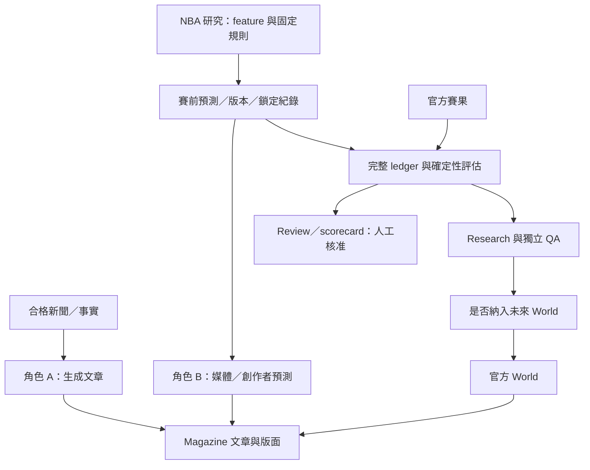

# MOSPORT Magazine Roadmap：文章生成與媒體角色 feature 驗證

版本：2026-11-19，Asia/Taipei。狀態：**計畫更新／工程未完成／尚未驗證公開部署**。

決策來源：[Magazine #19](https://github.com/mikemm5216/Mosport-Magazine/issues/19)、[NBA #170](https://github.com/mikemm5216/Mosport-NBA/issues/170)，以及 11/19 Founder 在對話中對 Magazine 兩角色的明確修正。文件更新沿用 [Magazine PR #20](https://github.com/mikemm5216/Mosport-Magazine/pull/20) 與 [NBA PR #73](https://github.com/mikemm5216/Mosport-NBA/pull/73) 的 `docs/architecture/WORLD_ENGINE_MASTER_ROADMAP.md`；不另建系統架構或派工佇列。

## 1. 目標與優先順序

Magazine 有兩個產品角色：**角色 A 生成文章；角色 B 把 feature 驗證包裝成媒體／創作者的預測專欄。** 此處 A／B 是同一產品的兩種用途，不是 Mosport-NBA／Mosport-Magazine 的 repository A／B。第一版讓讀者同時有文章可讀、有角色預測可追蹤，後台累積可檢驗的真實賽事紀錄。

203 項特徵盤點與新特徵探索持續並行。**第一篇真實文章與第一個可結算的角色預測一起進入首輪工程，不等全部特徵驗證完，也不必先證明研究有效或被正式 World 採納。** 用合格資料與事先固定的規則先做預測、鎖定、發布、結算，再觀察問題與效果。正式 World 主槽同步按自己的版本／發布契約接線。

後續完整 MVP 保留 NBA World、Magazine、Postgame Review、真實 Coach Arena 與合格 Media 內容的長期範圍。通用 World Engine、多運動擴展及更高階特徵屬後續能力，不縮減成單一比分網站，也不提前成為本次 Beta 的阻擋項。

### 決策優先順序

1. 11/19 的 launch-first 決定取代「完成全特徵研究後才上線」的排序。
2. [NBA #59](https://github.com/mikemm5216/Mosport-NBA/issues/59) 與 [#72 的 Founder 決策](https://github.com/mikemm5216/Mosport-NBA/pull/72) 已確定 **PMV 與 TMV 獨立，World 同時接收兩者與環境**。10/28 Founder 快照 C-1 的 `PMV → TMV` 是歷史文字，不再作為新工程設計依據；快照本身保留不改寫。
3. 11/19 Founder 的雙角色定義優先於先前「Magazine 只展示 World／Challenger 表格」的解讀。研究預測可以與正式 World 不同，也不必先升為正式模型才公開測試。
4. World 是唯一**官方**賽事判讀；官方主槽每場一個合格勝率，媒體／創作者預測使用獨立欄目。賽前整場範圍、公開 Review 人工核准與既有品牌視覺規則繼續有效。
5. 文件、PR、綠色測試及歷史 receipt 各自只證明其實際範圍，不推升 runtime、模型效果或公開部署狀態。

## 2. 兩個角色怎麼運作

| 產品角色 | 讀者看到的內容 | 背後工作 |
|---|---|---|
| **A：生成文章** | 真實新聞、賽事分析、專題與整理；有主題、來源與可讀敘事 | 合格新聞／資料 → 事實整理 → 文章生成 → 查核與發布；相關時引用已合格 World，不將每篇文章都綁定 World 預測 |
| **B：feature 驗證** | 有名字、有觀點的 MOSPORT 媒體／創作者預測：看好誰、理由、發布時間及歷史表現 | 角色與版本 → feature 假設／固定規則 → 賽前鎖定預測 → 官方賽果 → 完整實驗 ledger 與評估 |

角色 B 的讀者介面是專欄、文章或預測卡片，讓使用者像追蹤媒體作者或創作者觀點一樣閱讀。前台不必塞滿研究欄位；方法、版本與來源可從詳情查閱。角色採 MOSPORT 自有的名字與視角，不借用真實媒體／網紅身分或杜撰引用。

例如「輪休觀察室」「主場派」可以是**待討論的名稱提案**，分別對應固定的休息／主客場研究規則；這些不是已確認命名、既有角色或有效性結論。角色風格可以不同，預測結果由對應的已鎖規則產生，不能看完賽果再換一套角色定義。

### 讀者頁面

| 頁面 | NBA Beta 交付 | 缺失或尚未合格時 |
|---|---|---|
| Today／首頁 | 延續雜誌跨頁與手機封面；角色 A 文章及角色 B 專欄／預測卡片；獨立的官方 World 主槽每場至多一個合格勝率 | 沒有合格內容就移除該版位；不以正式 World 缺失為由隱藏已合格的研究欄目 |
| Schedule | 真實且可公開的 NBA 賽程與狀態；區分尚未發布、棄權、延期／取消 | 沒有 World 預測的比賽仍可列於合格賽程，不能假裝已預測 |
| Match Detail | 各媒體／創作者的賽前選擇、理由、時間與可查方法；正式 World 另列自身 INITIAL／FINAL 與版本 | 只有 pick 的角色不補百分比；不同觀點並列，不強迫與官方 World 一致 |
| Review | 官方結果連結角色當時的預測及理由，形成可追蹤歷史；正式 World／各研究角色／基準分別計分，經人工核准後公開 | 未結算、棄權與逾時如實列示；內部研究照完整 ledger 評估，不等文章或 Review 公開 |

「每場單一主數字」只適用於**官方 World 主槽**。角色 B 有自己的媒體／創作者欄目與預測卡片，可在首頁、文章與 Match Detail 呈現不同觀點；不把它藏成只能在研究表格查看的 Challenger。沿用既有設計系統安排內容，不需要整站重設計。

### 角色 B 如何驗證新特徵

- NBA 研究服務事先登記假設、固定預測規則、資料 cutoff、feature／參數版本、賽事母體與評估窗口，綁定 `personaId + personaVersion`、experiment／cohort／forecast receipts。角色變更方法須建立新版本。
- 固定規則可產生勝負 pick，或在具備合格機率模型時產生機率。Magazine／LLM 生成理由與文風，不能任意改 pick、憑文字語氣補機率，或讓文章生成偷偷變成另一個模型。
- 研究角色不用等待正式 World 採納，也可以提出相反觀點。比較特徵效果時用同場凍結輸入與固定對照；若資料／覆蓋條件不同，先揭露差異。
- 所有預先納入場次、未選用文章、棄權、逾時與落敗都進入完整 ledger。編輯選題決定曝光，不決定哪些比賽能計入研究。
- pick-only 以命中、錯誤、覆蓋率與適用的同場比較評估；只有事先鎖定的合格數值機率才計 Brier／log loss。正式 World、各角色與基準分開，不混合分母或不同版本。
- 賽後依官方結果確定性計分；Media 呈現角色紀錄，Research／QA 判斷證據，World 再決定是否納入未來版本。幾場命中不會自動升版；新假設使用新的前瞻窗口。

## 3. 產品與責任邊界

內部評估、Research 與 QA 使用完整 ledger，不依賴文章或公開 Review 是否獲准；只有對外呈現受到發布核准限制。

此圖是目標流程，沒有宣稱所有節點已上線。**repository 分工**仍為 Mosport-NBA 提供正式 World、研究計算、鎖定與官方結果契約，Mosport-Magazine 提供文章生成、角色敘事、展示及 Review 工作流。正式 World 保有唯一官方判讀；研究角色不冒充正式 World，但不用與它一致。Elo 是比較基準，不替代缺失 World。

Founder 直接管理 DATA、WORLD、MEDIA、COACH、QA 的責任；CONTROL／CAPACITY 提供派工、進度、容量與停止／恢復紀錄，不另設 Supervisor，也不替代部門或 Founder 的決策。

正式執行以雲端為目標。排程、鎖定、傳輸與結算不能依賴 MichaelPC 開機、瀏覽器常駐或 ChatGPT／Grok／Claude 對話額度。沿用既有 Control 工作，不建立第二套佇列。大型儀表板、完整本機模型或硬體升級不是 Beta 前置條件。

## 4. 分階段交付

以下是依證據推進的里程碑，不是已完成狀態或承諾日期。保留既有工作包編號，縮小首輪範圍，不增加一套平行 gate。

| 階段 | 最小成果 | 主要既有工作包／依賴 | 完成證據 |
|---|---|---|---|
| **M0：首版兩角色與契約** | 選定第一篇文章來源與第一個 feature 規則／角色版本；分清文章、研究預測與官方 World 的發布契約 | B-P2-01b/02/03、B-P3-03/04；NBA REL-00、SNAP／SERVE；NBA #73、B #20 | 真實資料、角色與規則對應、版本化 payload、首輪賽事集合與發布責任；不放寬 v1 |
| **M1：第一篇文章＋第一個角色預測** | 角色 A 從真實來源生成可發布文章；角色 B 對未來賽事發布固定規則 pick／合格機率，完成紀錄與結算；正式 World 雙版接線並行 | B-P2-02/03、B-P3-01/02/03/04；NBA 研究預測／持久化／settlement | 真實文章及引用；角色預測／理由／時間；賽前 receipt 與官方結果；公開 Review 經核准，內部完整 ledger 不受選題影響 |
| **M2：兩角色 Beta 可用** | 實際 HTTPS 上有可讀文章、可追蹤的角色預測與歷史紀錄；正式 World 合格時進自己的主槽；四頁流程可用 | 前階段、B-P1-06、B-P2-01b；REL-01…07 與 REL-08 首日證據，首週盤點接 M3 | 兩角色均有實際內容與完整賽事日紀錄；發布／撤回／結算／回復有效；僅 World 表格或僅賽程網站不等於 Magazine Beta 完成 |
| **M3：擴大角色與驗證證據** | 擴充文章題材、角色／feature 實驗、同場比較與歷史表現；依實際使用與證據改善產品及未來 World | B-P2-01b/03、B-P3-01/02/03/04；NBA SCI／BASE／AUDIT／SHADOW | 各角色版本可追溯、完整分母、適當指標與不確定性；升版另有研究／QA／release 決策 |
| **M4：完整 MVP 與後續擴展** | Coach Arena 身分／挑戰／鎖定／分享／結算；更完整 Media 文章與 Podcast／圖片 short 草稿流程；按瓶頸擴容 | B #17、#18、B-P3-03/04/05；對應 NBA 契約與雲端能力 | 各產品鏈真實端到端證據；腳本與音訊／影片成品分別交付；多運動另有資料／模型／權利驗收 |

M0–M4 與 NBA 主 roadmap 對齊；M1 各鏈並行且分別記錄進度，M2 保留兩項不同完成聲明。M2 分別記錄兩項交付：**Magazine 雙角色 Beta** 可先發布已合格的文章與角色 B 預測，完成賽前鎖定、發布及官方結算；**NBA 整合預測 Beta** 另須正式 World 數值、INITIAL／T−15 FINAL 與其公開閉環。正式 World 尚未合格，不阻擋已具自身發布資格的 A／B；Magazine 先完成也不代表整合 World 已完成。這是同一 roadmap 的範圍記錄，不新增 gate。

先前把首個真實 Challenger 延後到 L3／M3、首輪只呈現 Current World 的安排是文件作者的假設，已由 Founder 的雙角色說明取代。**角色 A 與角色 B 從 M1 同時交付，M3 擴大證據與角色規模。**

203 特徵研究與新候選從 M0 起並行；每次只取可負擔、可解釋的一批。M4 不以完成全部 203 項驗證為條件，長期完整 World Engine 能力持續擴充。

### Beta 所需的少數實質檢查

1. **兩角色都有真實輸出：**文章能回到來源，角色 pick／機率能回到固定規則、資料快照與版本；研究尚未證實有效可以先測試，資料或時間來源不明則不能當作已鎖預測。
2. **時間與保管：**分開記錄資料截止、計算、鎖定與實際發布時間。資料較早不代表晚到的 FINAL 準時；快取過期也不能抹掉原預測。
3. **可回復的完整流程：**真實跨 repo 傳輸、文章生成與核准、角色發布、撤回、官方結算、錯誤顯示及 rollback 有具體證據。
4. **適用的審查與首次公開決策：**既有獨立 QA、來源／素材資格及已選主機的發布程序；不把每個研究結論或大型治理工具列為先決條件。

## 5. 工作包盤點與接續位置

基線為 Magazine `main@e4874cba32a7f91c110167bc3ea9e5f779294ed1`。表中的「main 已有」只描述可讀程式／文件，不代表已重新測試或部署。

| WP | 現有成果 | 本輪接續與狀態 |
|---|---|---|
| B-P0-01 | Repo、agent guide、Founder 原文快照 | 已有；不修改歷史鎖定來源 |
| B-P0-02 | Roadmap、issues 與驗收 | 本次依 Founder 雙角色修正更新 #20／#19／NBA #73／#170 |
| B-P1-01 | tokens、自架字型、日夜／中英 | 保留既有設計；不做重設計 |
| B-P1-02 | BrandLogo／TeamLogo／CoverArtwork 插槽 | 使用已合格素材與可讀 fallback |
| B-P1-03 | 呈現資格 gate | main 有原型；正式發布仍需上游可信權限 |
| B-P1-04 | 桌面跨頁／手機封面與 Today | 以既有版型安排文章、媒體／創作者卡片及獨立官方 World 主槽 |
| B-P1-05 | Schedule／Review／Match／Almanac 入口 | 本輪聚焦 NBA 四頁閉環 |
| B-P1-06 | 瀏覽器矩陣與截圖 | 真實 consumer 接線後核對核心流程與手機；歷史原型截圖不能替代 |
| B-P1-07 | Reader Zoom | 保留 Fit Width／Fit Page 與手機原生 pinch |
| B-P1-08 | 素材 registry 與候選美術 | #5／#7 既有權利與視覺事項按實際選用素材處理；未清權利就 fallback |
| B-P2-01a | main 有 A v1 validator 與內部 inspector | **PARTIAL：內部可讀；無公開數值** |
| B-P2-01b | NBA 公開預測讀取與四頁接線 | **P0／未完成**；分別對接正式 World 與版本化研究預測，不放寬 v1 |
| B-P2-02 | main 有 B-owned 內容契約與原型 store | **P0：**文章來源／生成／發布及角色版本／預測引用；不將自填 approver ID 當認證 |
| B-P2-03 | main 有 provider → contracts → gate → public model | **P0：**同一路徑接文章、研究角色及正式 World，分清 payload 類型 |
| B-P3-01 | main 有 DEMO 工作流、receipts、更正／撤回 | **P0：**兩角色的真實發布紀錄與核准、公開 Review；DEMO persistence 不是 production |
| B-P3-02 | main 有風險路由及 M-01…M-07 案例 | 公開 Review／scorecard 仍為 HUMAN，既有高風險規則保留 |
| B-P3-03 | 來源 inventory 與離線 injury parser | 現有為有限離線能力；依首版需要接真實來源，非全新聞來源前置條件 |
| B-P3-04 | Evidence Candidate 草稿 builder／validator | **P0：**承接角色 B 的 feature 假設、規則、persona 版本與完整 ledger；測試不用先納入正式 World |
| B-P3-05 | DEMO 內部 editor | 重用其操作流程；完整編輯工具後續完成，不阻擋最小可信 Review 流程 |

### 已有 PR 的角色

| 既有工作 | 可承接用途 | 不能據此宣稱 |
|---|---|---|
| [B #14](https://github.com/mikemm5216/Mosport-Magazine/pull/14)、[#15](https://github.com/mikemm5216/Mosport-Magazine/pull/15) | 內部球隊／球員觀測讀取工作 | 已有正式名單、數值 World 或公開資料服務 |
| [B #16](https://github.com/mikemm5216/Mosport-Magazine/pull/16) | 鎖定 World 的離線 consumer | 已驗證 live transport、撤回與正式發布 |
| [B #17](https://github.com/mikemm5216/Mosport-Magazine/pull/17) | Coach Arena 的後續候選實作 | 真實使用者身分／公開擂台／結算已完成；它不阻擋 NBA 預測 Beta |
| [B #18](https://github.com/mikemm5216/Mosport-Magazine/pull/18) | 既有文章草稿能力可承接角色 A 首輪；Podcast／short storyboard 接後續範圍 | 已發布合格文章或已產生音訊／影片；當前草稿仍有自身內部資格 |
| [A #168](https://github.com/mikemm5216/Mosport-NBA/pull/168) | PMV、獨立 TMV、World 的內部數值候選與比較研究 | 已公開可用或已證明未來效果 |

接續時讀取各 PR 當下 HEAD、相依堆疊與 review；不複製相同功能開第二條實作線，也不因 roadmap 更新自動合併。

## 6. 發布、Review 與升版

**現在就適用：**計分與資料準備可以自動執行，但所有 Public Postgame Review（包含其公開 scorecard）仍需符合現行人工核准規則。不能改稱「成績頁」以繞過規則；未來擴大自動發布範圍是另一個明確的政策變更。

Forecast、角色文章／卡片、官方結果、evaluation 與 editorial approval 是不同紀錄。角色內容引用固定的 forecast receipt，保留當時 pick、理由與發布時間；更正／撤回建立新事件，不覆寫原預測或悄悄移除落敗、棄權、晚鎖場次。內部研究使用全部 ledger，與編輯是否選稿、公開 Review 是否核准分開。初期運作紀錄用於確認系統可靠；樣本不足如實說明，不能把第一週通過視為 feature 有效證明。

角色本身的預測成績，與 feature 對正式 World 的增益是兩個問題。角色命中率高不能直接證明該 feature 改善 World；後者需同場、同 stage、固定其他條件的有／無 feature 對照，並以後續未參與選擇的資料確認。

實驗成績按預先定義的窗口與主要指標解讀，同場比較、實際效果與不確定性一起呈現。World 版本更新須有時間外證據、獨立 QA 與正式 release 決策，只影響未來預測。保留既有定期檢討方向，不把定期檢討誤寫成自動升版或升版截止日。

## 7. 容量與實際限制

CONTROL／CAPACITY 先用既有 ledger 記錄供應商／worker、可用額度、reset 時間、排隊量、失敗／重試、成本與 CPU／RAM／儲存觀測；不知道的值記 UNKNOWN。優先保障資料、鎖定、發布、結算及其必要 QA，再分配研究與內容工作。

額度用完就暫停並按可用時間恢復，不能重複派工碰撞限制。Grok C1 handoff 已列為停止工作，不再是上線依賴；這不是宣稱外部 Routine 已被遠端關閉。雲端 runtime 與 LLM 研發工作分開，對話額度用完不應讓已發布產品停止結算。

本機模型可在有任務基準後承接適合的草稿／整理工作；先量測瓶頸，再提出硬體或軟體升級。現有文件未提供完整主機規格、額度或 production host，不猜測，不把購買設備或新增付費服務當成本次文件的既成事實。

## 8. 驗收與狀態更新

沿用 U-01、U-04…U-07 與 M-01…M-07：空內容移除、主頁單一數字、Logo fallback、中英／日夜／手機可讀、無球員肖像、錯誤核准不可通過。新增的真實契約、撤回、雙鎖、結算與實驗版本案例，在對應工程 PR 加入有針對性的測試；文件更新不創造測試通過證據。

每次交付列明實際 SHA、完成範圍、未完成依賴與下一工作包。當日 [plan-versus-actual](reports/2026-11-19-LAUNCH-FIRST-PLAN-VS-ACTUAL.md) 維持 OPEN，直到有真正的當日結束紀錄；不因一次回覆或 PR 完成而宣稱整日任務結案。
