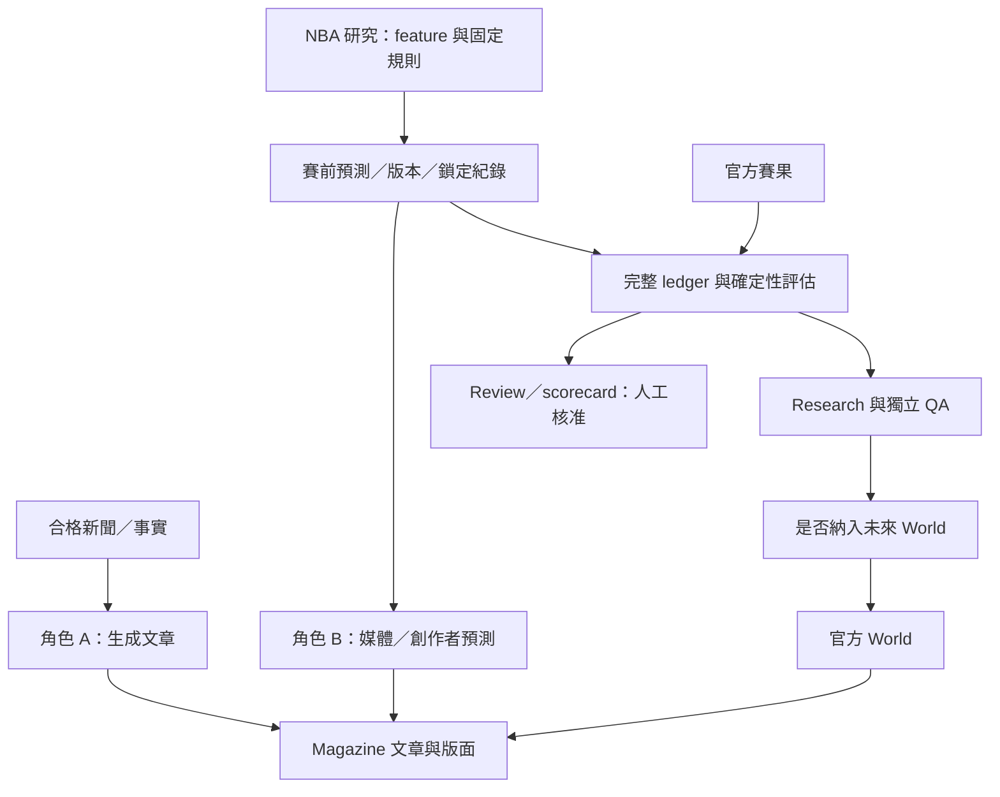

# MOSPORT Magazine Roadmap：Beta-0 真資料閉環，再接 Beta-1

版本：2026-11-19，Asia/Taipei。狀態：**計畫更新／工程未完成／尚未驗證公開部署**。

決策來源：[Magazine #19](https://github.com/mikemm5216/Mosport-Magazine/issues/19)、[NBA #170](https://github.com/mikemm5216/Mosport-NBA/issues/170)，以及 11/19 Founder 在對話中對 Magazine 兩角色的明確修正。文件更新沿用 [Magazine PR #20](https://github.com/mikemm5216/Mosport-Magazine/pull/20) 與 [NBA PR #73](https://github.com/mikemm5216/Mosport-NBA/pull/73) 的 `docs/architecture/WORLD_ENGINE_MASTER_ROADMAP.md`；不另建系統架構或派工佇列。

## 1. 目標與優先順序

**Beta-0 目標為 2026-11-19 起 2–3 週，即 12/03–12/10（Asia/Taipei）**；這是目標窗口，不是已排程或工期保證。先讓至少一場真正未來比賽的資料走過「持久化賽前 snapshot → Magazine 呈現或明確 missing → 同 game ID 官方賽後結果」，把真資料閉環上線。真實 schedule 可顯示就顯示，無資料則誠實 missing；沒有 World 勝率也可以。

**至少一筆真實 snapshot 與官方結果的底層證據不可用 missing 取代。** snapshot 必須在該場真正開打前取得並持久保存，使用少數現有 feature 即可。Beta-0 不要求 T−15 雙鎖、多 feature、角色 B 或完整文章流程。Beta-0 已跑過真資料且已上線後，Beta-1 才加入 INITIAL／T−15 FINAL、更多 feature 與角色 B。

Magazine 保留兩個產品角色：A 生成文章，B 將 feature 驗證呈現為媒體／創作者預測；此處 A／B 與 repository 代號不同。角色 A 可獨立使用已合格來源產文，但不加成 Beta-0 必需條件。Beta-0 上線前 Research **只修補直接解除 Launch 缺口的既有實作，不開新 feature calculator 或模型實驗**。203 項清單保留，不再並行擴寫；後續恢復的研究仍須容量 ALLOW。

後續完整 MVP 保留 NBA World、Magazine、Postgame Review、真實 Coach Arena 與合格 Media 內容的長期範圍。通用 World Engine、多運動擴展及更高階特徵屬後續能力，不縮減成單一比分網站，也不提前成為本次 Beta 的阻擋項。

### 決策優先順序

1. 11/19 最新 Beta-0／Beta-1 決定取代「首輪必須雙角色、數值 World、雙鎖」及「203 項並行擴寫」的排序。首版只以本節真資料閉環為必要範圍。
2. [NBA #59](https://github.com/mikemm5216/Mosport-NBA/issues/59) 與 [#72 的 Founder 決策](https://github.com/mikemm5216/Mosport-NBA/pull/72) 已確定 **PMV 與 TMV 獨立，World 同時接收兩者與環境**。10/28 Founder 快照 C-1 的 `PMV → TMV` 是歷史文字，不再作為新工程設計依據；快照本身保留不改寫。
3. 雙角色產品方向保留；角色 B 放入 Beta-1，角色 A 可用已合格來源獨立產文。未來研究預測可與正式 World 不同，不必先升為正式模型才測試。
4. World 是唯一**官方**賽事判讀；官方主槽每場一個合格勝率，媒體／創作者預測使用獨立欄目。賽前整場範圍、公開 Review 人工核准與既有品牌視覺規則繼續有效。
5. 文件、PR、綠色測試及歷史 receipt 各自只證明其實際範圍，不推升 runtime、模型效果或公開部署狀態。

## 2. 兩個角色的後續產品方向

本節保留產品設計；角色 B 與較完整文章流程屬 Beta-1 及後續範圍，**不作 Beta-0 新依賴**。角色 A 在已有合格來源且不衝突 Launch／容量時可獨立交付。

| 產品角色 | 讀者看到的內容 | 背後工作 |
|---|---|---|
| **A：生成文章** | 真實新聞、賽事分析、專題與整理；有主題、來源與可讀敘事 | 合格新聞／資料 → 事實整理 → 文章生成 → 查核與發布；相關時引用已合格 World，不將每篇文章都綁定 World 預測 |
| **B：feature 驗證** | 有名字、有觀點的 MOSPORT 媒體／創作者預測：看好誰、理由、發布時間及歷史表現 | 角色與版本 → feature 假設／固定規則 → 賽前鎖定預測 → 官方賽果 → 完整實驗 ledger 與評估 |

角色 B 的讀者介面是專欄、文章或預測卡片，讓使用者像追蹤媒體作者或創作者觀點一樣閱讀。前台不必塞滿研究欄位；方法、版本與來源可從詳情查閱。角色採 MOSPORT 自有的名字與視角，不借用真實媒體／網紅身分或杜撰引用。

例如「輪休觀察室」「主場派」可以是**待討論的名稱提案**，分別對應固定的休息／主客場研究規則；這些不是已確認命名、既有角色或有效性結論。角色風格可以不同，預測結果由對應的已鎖規則產生，不能看完賽果再換一套角色定義。

### 讀者頁面

| 頁面 | Beta-1 及後續呈現方向 | 缺失或尚未合格時 |
|---|---|---|
| Today／首頁 | 延續雜誌跨頁與手機封面；角色 A 文章及角色 B 專欄／預測卡片；獨立的官方 World 主槽每場至多一個合格勝率 | 沒有合格內容就移除該版位；不以正式 World 缺失為由隱藏已合格的研究欄目 |
| Schedule | 真實且可公開的 NBA 賽程與狀態；區分尚未發布、棄權、延期／取消 | 沒有 World 預測的比賽仍可列於合格賽程，不能假裝已預測 |
| Match Detail | 各媒體／創作者的賽前選擇、理由、時間與可查方法；正式 World 另列自身 INITIAL／FINAL 與版本 | 只有 pick 的角色不補百分比；不同觀點並列，不強迫與官方 World 一致 |
| Review | 官方結果連結角色當時的預測及理由，形成可追蹤歷史；正式 World／各研究角色／基準分別計分，經人工核准後公開 | 未結算、棄權與逾時如實列示；內部研究照完整 ledger 評估，不等文章或 Review 公開 |

「每場單一主數字」只適用於**官方 World 主槽**。角色 B 有自己的媒體／創作者欄目與預測卡片，可在首頁、文章與 Match Detail 呈現不同觀點；不把它藏成只能在研究表格查看的 Challenger。沿用既有設計系統安排內容，不需要整站重設計。

### Beta-1 的角色 B 如何驗證新特徵

- NBA 研究服務事先登記假設、固定預測規則、資料 cutoff、feature／參數版本、賽事母體與評估窗口，綁定 `personaId + personaVersion`、experiment／cohort／forecast receipts。角色變更方法須建立新版本。
- 固定規則可產生勝負 pick，或在具備合格機率模型時產生機率。Magazine／LLM 生成理由與文風，不能任意改 pick、憑文字語氣補機率，或讓文章生成偷偷變成另一個模型。
- 研究角色不用等待正式 World 採納，也可以提出相反觀點。比較特徵效果時用同場凍結輸入與固定對照；若資料／覆蓋條件不同，先揭露差異。
- 所有預先納入場次、未選用文章、棄權、逾時與落敗都進入完整 ledger。編輯選題決定曝光，不決定哪些比賽能計入研究。
- pick-only 以命中、錯誤、覆蓋率與適用的同場比較評估；只有事先鎖定的合格數值機率才計 Brier／log loss。正式 World、各角色與基準分開，不混合分母或不同版本。
- 賽後依官方結果確定性計分；Media 呈現角色紀錄，Research／QA 判斷證據，World 再決定是否納入未來版本。幾場命中不會自動升版；新假設使用新的前瞻窗口。

## 3. 產品與責任邊界

內部評估、Research 與 QA 使用完整 ledger，不依賴文章或公開 Review 是否獲准；只有對外呈現受到發布核准限制。

此圖是 Beta-1 及後續的目標流程，沒有宣稱所有節點已上線，也不是 Beta-0 驗收清單。**repository 分工**仍為 Mosport-NBA 提供共用 API、正式 World、研究計算、snapshot 與官方結果，Mosport-Magazine 提供 reader flow、文章、角色敘事與 Review。正式 World 保有唯一官方判讀；研究角色不用與它一致。Elo 是比較基準，不替代缺失 World。

Founder 直接管理 DATA、WORLD、MEDIA、COACH、QA。**Magazine 在既有 MEDIA 責任內擔任產品 owner**，自行安排文章、reader flow 與驗收，不等 World 完整版；共用 API／數值由 NBA 提供。Launch／Research 是工作線，不增加部門。Capacity／Control 是有開工否決權的窄只讀守門者，Boundary／Anti-Duplication 是 QA 內的窄角色；兩者不成為 Supervisor、不更動產品架構或派工優先。

正式執行以雲端為目標。排程、鎖定、傳輸與結算不能依賴 MichaelPC 開機、瀏覽器常駐或 ChatGPT／Grok／Claude 對話額度。沿用既有 Control 工作，不建立第二套佇列。大型儀表板、完整本機模型或硬體升級不是 Beta 前置條件。

### 球員評分與 Fantasy 共用引擎價值

**球員評分與 Fantasy 的方向：**沿用現有 feature→PMV／獨立 TMV／環境→World，在同一引擎版本導出正式球員價值。Magazine 展示及文章引用這份分數，Fantasy 後續以同一價值紀錄作價格依據；不另建 Rating 加減分規則或把輸出循環餵回同次 World。ENGINE-03／04、SERVE-01／02 接續既有實作確認球員層輸出；Fantasy 不是 Beta-0／Beta-1 前置條件，具體換價尚未定義。

角色 A 的球員評分文章引用正式 World 球員價值及其依據；Beta-1 的角色 B 研究不另立評分權重。候選經正式升版才影響後續官方分數。球員評分與賽事主勝率使用各自清楚的標示與版位。賽前分數、賽後更新及價格各自引用當時版本，不能回寫歷史。

## 4. 分階段交付

保留既有工作包編號，以 Beta-0／Beta-1 重排 M0–M4。Beta-0 目標 12/03–12/10，完成仍須實際證據；Beta-1 沒有本輪另行承諾日期。

| 階段 | 最小成果 | 主要既有工作包／依賴 | 完成證據 |
|---|---|---|---|
| **M0：Beta-0 盤點與小範圍接線** | 完成 EIC、確認可重用 snapshot／來源／game ID／reader 路徑，取得窄任務 Capacity ALLOW | B-P0-02、B-P2-01a/01b/03；NBA 既有 DATA／SNAP／SERVE；NBA #73、B #20 | searched／found／reuse 三項具體；缺口、消耗上限、quota／優先衝突記錄完整；不開新 calculator |
| **M1：Beta-0 第一場真資料** | 至少一場真正未來賽事，在賽前以少數現有 feature 產生持久化 snapshot；Magazine 顯示它或明確 missing | B-P2-01b/03；NBA 既有資料／snapshot／持久化的直接修補 | game ID、真實來源與取得時間、snapshot／持久化 receipt；無 World 勝率也可，不要求 INITIAL／T−15 雙鎖 |
| **M2：Beta-0 上線與官方結果閉環** | 真實 schedule 或誠實 missing；實際上線後，按同一 game ID 對上官方賽後結果 | 前階段、B-P1-06；既有發布／監控／回復工作中適用的最小範圍 | 實際位址、reader 呈現／missing、至少一筆底層真 snapshot 與官方結果 join；不能以全 missing 或文件替代 |
| **M3：Beta-1** | Beta-0 已跑真資料且上線後，補 INITIAL／T−15 FINAL、更多 feature 與角色 B；角色 A 依合格來源持續獨立交付 | B-P2-01b/02/03、B-P3-01/02/03/04；NBA 既有 engine／research／serving | 雙鎖與實際發布時間、角色規則／版本／receipt、同場評估；每個新任務先經 EIC／容量 ALLOW |
| **M4：完整 MVP 與後續擴展** | Coach Arena 身分／挑戰／鎖定／分享／結算；更完整 Media 文章與 Podcast／圖片 short 草稿流程；按瓶頸擴容 | B #17、#18、B-P3-03/04/05；對應 NBA 契約與雲端能力 | 各產品鏈真實端到端證據；腳本與音訊／影片成品分別交付；多運動另有資料／模型／權利驗收 |

Beta-0 是 M0–M2 的真資料閉環；Beta-1 是達成真資料與實際上線兩項條件後的 M3。先前「M1 雙角色、M2 雙角色 Beta 與整合預測 Beta」排序已被此決定取代，不能再拿來增加 Beta-0 範圍。

角色 A 的已有合格來源文章可自行安排，不需完整 World；它與完整文章工作流都不是 Beta-0 必需成果。角色 B、T−15 雙鎖與更多 feature 明列 Beta-1，Fantasy 不阻擋 Beta-0 或 Beta-1。

203 項清單與既有證據保留。**Beta-0 上線前禁止並行擴寫新 calculator／新模型實驗**；Research 僅能修補直接解除 Launch 缺口的既有東西，且仍要 EIC 與容量 ALLOW。Beta-1 才按實測容量安排更多 feature／角色研究，長期 World Engine 方向保留。

### Beta-0 的最小完成證據

1. **真實賽程或誠實 missing：**reader 不以 DEMO 冒充當日賽程。
2. **至少一筆真 snapshot：**對真正未來比賽，賽前取得資料並持久保存，game ID、來源、時間與 receipt 可讀回；沒有 World 機率也可。
3. **Magazine 與官方結果：**呈現該 snapshot 或明確 missing；賽後將同 game ID 對上官方結果。畫面 missing 不能取代後台真 snapshot／官方結果證據。
4. **適用的審查與實際上線：**對最小流程完成獨立檢查、既有來源／發布資格與 L2 首次公開決策，留下實際位址及回復方法。完整文章、公開 Review 與雙鎖不是本階段新增前置條件；若公開 Review，原人工核准規則仍適用。

## 5. 工作包盤點與接續位置

基線為 Magazine `main@e4874cba32a7f91c110167bc3ea9e5f779294ed1`。表中的「main 已有」只描述可讀程式／文件，不代表已重新測試或部署。

| WP | 現有成果 | 本輪接續與狀態 |
|---|---|---|
| B-P0-01 | Repo、agent guide、Founder 原文快照 | 已有；不修改歷史鎖定來源 |
| B-P0-02 | Roadmap、issues 與驗收 | 本次依 Beta-0／Beta-1、EIC／容量／分級決定更新 #20／#19／NBA #73／#170 |
| B-P1-01 | tokens、自架字型、日夜／中英 | 保留既有設計；不做重設計 |
| B-P1-02 | BrandLogo／TeamLogo／CoverArtwork 插槽 | 使用已合格素材與可讀 fallback |
| B-P1-03 | 呈現資格 gate | main 有原型；正式發布仍需上游可信權限 |
| B-P1-04 | 桌面跨頁／手機封面與 Today | Beta-0 重用既有 reader 呈現 snapshot／missing；角色欄目接 Beta-1 |
| B-P1-05 | Schedule／Review／Match／Almanac 入口 | 本輪聚焦 NBA 四頁閉環 |
| B-P1-06 | 瀏覽器矩陣與截圖 | 真實 consumer 接線後核對核心流程與手機；歷史原型截圖不能替代 |
| B-P1-07 | Reader Zoom | 保留 Fit Width／Fit Page 與手機原生 pinch |
| B-P1-08 | 素材 registry 與候選美術 | #5／#7 既有權利與視覺事項按實際選用素材處理；未清權利就 fallback |
| B-P2-01a | main 有 A v1 validator 與內部 inspector | **PARTIAL：內部可讀；無公開數值** |
| B-P2-01b | NBA 公開讀取與頁面接線 | **Beta-0：**最小 snapshot／missing 與官方結果引用；數值／雙鎖／研究公開接 Beta-1，不放寬 v1 |
| B-P2-02 | main 有 B-owned 內容契約與原型 store | 只修補直接影響 Beta-0 的既有 gap；角色 A 已合格來源可獨立產文，完整流程非 Beta-0 必需 |
| B-P2-03 | main 有 provider → contracts → gate → public model | **Beta-0：**重用同一路徑接 snapshot／missing；角色 B payload 接 Beta-1 |
| B-P3-01 | main 有 DEMO 工作流、receipts、更正／撤回 | Beta-0 僅處理所選發布路徑的直接缺口；完整兩角色及 Review workflow 接後續 |
| B-P3-02 | main 有風險路由及 M-01…M-07 案例 | 公開 Review／scorecard 仍為 HUMAN，既有高風險規則保留 |
| B-P3-03 | 來源 inventory 與離線 injury parser | 現有為有限離線能力；依首版需要接真實來源，非全新聞來源前置條件 |
| B-P3-04 | Evidence Candidate 草稿 builder／validator | Beta-0 前只准直接解除 Launch 缺口的既有修補；角色 B 的新實驗／persona 接 Beta-1 |
| B-P3-05 | DEMO 內部 editor | 重用其操作流程；完整編輯工具後續完成，不阻擋最小可信 Review 流程 |

### 已有 PR 的角色

| 既有工作 | 可承接用途 | 不能據此宣稱 |
|---|---|---|
| [B #14](https://github.com/mikemm5216/Mosport-Magazine/pull/14)、[#15](https://github.com/mikemm5216/Mosport-Magazine/pull/15) | 內部球隊／球員觀測讀取工作 | 已有正式名單、數值 World 或公開資料服務 |
| [B #16](https://github.com/mikemm5216/Mosport-Magazine/pull/16) | 鎖定 World 的離線 consumer | 已驗證 live transport、撤回與正式發布 |
| [B #17](https://github.com/mikemm5216/Mosport-Magazine/pull/17) | Coach Arena 的後續候選實作 | 真實使用者身分／公開擂台／結算已完成；它不阻擋 Beta-0 |
| [B #18](https://github.com/mikemm5216/Mosport-Magazine/pull/18) | 角色 A 可重用的文章草稿能力；完整文章／影音流程後續完成 | 已發布合格文章或已產生音訊／影片；它不是 Beta-0 必需 |
| [A #168](https://github.com/mikemm5216/Mosport-NBA/pull/168) | PMV、獨立 TMV、World 的內部數值候選與比較研究 | 已公開可用或已證明未來效果 |

接續時讀取各 PR 當下 HEAD、相依堆疊與 review；不複製相同功能開第二條實作線，也不因 roadmap 更新自動合併。

## 6. 發布、Review 與升版

**現在就適用：**計分與資料準備可以自動執行，但所有 Public Postgame Review（包含其公開 scorecard）仍需符合現行人工核准規則。不能改稱「成績頁」以繞過規則；未來擴大自動發布範圍是另一個明確的政策變更。

Forecast、角色文章／卡片、官方結果、evaluation 與 editorial approval 是不同紀錄。角色內容引用固定的 forecast receipt，保留當時 pick、理由與發布時間；更正／撤回建立新事件，不覆寫原預測或悄悄移除落敗、棄權、晚鎖場次。內部研究使用全部 ledger，與編輯是否選稿、公開 Review 是否核准分開。初期運作紀錄用於確認系統可靠；樣本不足如實說明，不能把第一週通過視為 feature 有效證明。

角色本身的預測成績，與 feature 對正式 World 的增益是兩個問題。角色命中率高不能直接證明該 feature 改善 World；後者需同場、同 stage、固定其他條件的有／無 feature 對照，並以後續未參與選擇的資料確認。

實驗成績按預先定義的窗口與主要指標解讀，同場比較、實際效果與不確定性一起呈現。World 版本更新須有時間外證據、獨立 QA 與正式 release 決策，只影響未來預測。保留既有定期檢討方向，不把定期檢討誤寫成自動升版或升版截止日。

## 7. 容量與實際限制

**Capacity／Control 是派出新任務前的窄只讀守門者，有開工否決權。** 檢查 EIC、預估消耗／硬上限／quota 狀態與 Launch 優先衝突，留下 ALLOW 或 STOP；沒有 ALLOW 不開始寫 code。資料未知記 UNKNOWN，不能冒稱額度足夠。先用簡單既有任務紀錄，不建新 dashboard、queue 或 workflow；守門者不更動架構或派工優先。

容量不足或遇限額就停、保存進度，不重試碰撞限制；恢復前重新核對可用條件與窄任務範圍。Grok C1 handoff 已列為停止工作，不是上線依賴，也沒有宣稱外部 Routine 已被遠端關閉。目標雲端 runtime 與 LLM 研發工作分開，對話額度用完不應讓產品停止結算。

### Existing Implementation Check 與 QA 防重複

每個 Launch PR 必填 **Existing Implementation Check** 三項：`searched`（實際 paths／PR／HEAD 或 ref／commands）、`found`（已存在的實作與缺口）、`reuse / why not reused`（重用位置與每項不重用理由）。若全部沿用，明寫「未重用項：無，全部沿用」；不能用 N/A 或空泛敘述取代。缺段／內容空泛即不合格，不得 ready／merge。

QA 內的 **Boundary／Anti-Duplication** 在開 PR 前強制檢查 EIC，review 時抓重複實作，可阻擋 ready／merge；不寫產品程式、不改架構、不設定派工優先。作者不能自審；沿用 [AGENTS](../AGENTS.md) 與 [PR template](../.github/pull_request_template.md)，不另建治理系統。

### Founder 分級

| 級別 | 依實際影響判定 | 處理方式 |
|---|---|---|
| L0 | 已授權範圍內的文件／測試／明確修補 | 指定獨立 agent 審查通過後依既有委派處理，Founder 抽查 |
| L1 | 契約／calculator／顯示邏輯 | 提供 Founder 摘要與關鍵 diff，由其決定；仍需獨立 review |
| L2 | 架構／Gate／公開／付費／權限政策 | Founder 親決；仍需獨立 review |

按最高實際影響分級，不因副檔名為 `.md` 降成 L0。本次具體政策方向已獲 Founder 在對話授權，不反覆詢問；授權範圍、獨立 review 與實際操作分別留證，本輪不 merge。

本機模型可在有任務基準後承接適合的草稿／整理工作；先量測瓶頸，再提出硬體或軟體升級。現有文件未提供完整主機規格、額度或 production host，不猜測，不把購買設備或新增付費服務當成本次文件的既成事實。

## 8. 驗收與狀態更新

沿用 U-01、U-04…U-07 與 M-01…M-07：空內容移除、主頁單一數字、Logo fallback、中英／日夜／手機可讀、無球員肖像、錯誤核准不可通過。新增的真實契約、撤回、雙鎖、結算與實驗版本案例，在對應工程 PR 加入有針對性的測試；文件更新不創造測試通過證據。

每次交付列明實際 SHA、完成範圍、未完成依賴與下一工作包。當日 [plan-versus-actual](reports/2026-11-19-LAUNCH-FIRST-PLAN-VS-ACTUAL.md) 維持 OPEN，直到有真正的當日結束紀錄；不因一次回覆或 PR 完成而宣稱整日任務結案。
