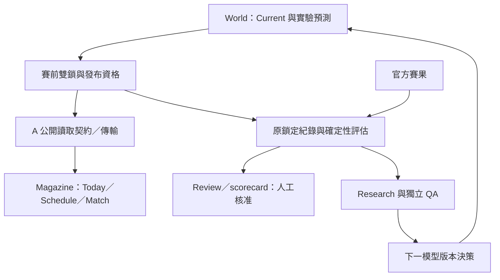

# MOSPORT Magazine Roadmap：NBA 先上線，真實賽事持續驗證

版本：2026-11-19，Asia/Taipei。狀態：**計畫更新／工程未完成／尚未驗證公開部署**。

決策來源：[Magazine #19](https://github.com/mikemm5216/Mosport-Magazine/issues/19)、[NBA #170](https://github.com/mikemm5216/Mosport-NBA/issues/170)。共同主文件沿用 [NBA PR #73](https://github.com/mikemm5216/Mosport-NBA/pull/73) 的 `docs/architecture/WORLD_ENGINE_MASTER_ROADMAP.md`；本文件落實 Magazine 工作包，不另建系統架構或派工佇列。

## 1. 目標與優先順序

第一個產品里程碑是 **NBA 預測 Beta**：在未來真實賽事前發布可追溯的 World 數值預測，透過 Magazine 讓使用者閱讀，賽後用官方結果檢討並持續修正產品。先把實際運作的問題找出來，再以累積證據改善後續模型。

203 項特徵盤點、既有研究與新特徵探索持續並行。**不必等所有特徵驗證完、跑完所有組合、證明勝過 Elo、完成所有影音與擂台功能，才交付第一版 NBA 預測 Beta。** 所選首版模型仍須有真實資料、可重現計算、賽前時序、版本與發布資格；未知保留未知，不能以假的機率補位。

後續完整 MVP 保留 NBA World、Magazine、Postgame Review、真實 Coach Arena 與合格 Media 內容的長期範圍。通用 World Engine、多運動擴展及更高階特徵屬後續能力，不縮減成單一比分網站，也不提前成為本次 Beta 的阻擋項。

### 決策優先順序

1. 11/19 的 launch-first 決定取代「完成全特徵研究後才上線」的排序。
2. [NBA #59](https://github.com/mikemm5216/Mosport-NBA/issues/59) 與 [#72 的 Founder 決策](https://github.com/mikemm5216/Mosport-NBA/pull/72) 已確定 **PMV 與 TMV 獨立，World 同時接收兩者與環境**。10/28 Founder 快照 C-1 的 `PMV → TMV` 是歷史文字，不再作為新工程設計依據；快照本身保留不改寫。
3. World 唯一賽事判讀、只做賽前整場預測、首頁單一主勝率、公開 Review 人工核准及既有品牌視覺規則繼續有效。
4. 文件、PR、綠色測試及歷史 receipt 各自只證明其實際範圍，不推升 runtime、模型效果或公開部署狀態。

## 2. 讀者會得到什麼

| 頁面 | NBA Beta 交付 | 缺失或尚未合格時 |
|---|---|---|
| Today／首頁 | 延續雜誌跨頁與手機封面；每場至多一個合格 Current World 主勝率，附版本／更新狀態入口 | 不顯示假數字、示意百分比或第二個競爭勝率；無合格內容就移除版位 |
| Schedule | 真實且可公開的 NBA 賽程與狀態；區分尚未發布、棄權、延期／取消 | 沒有 World 預測的比賽仍可列於合格賽程，不能假裝已預測 |
| Match Detail | 原已鎖定 INITIAL／FINAL、模型版本、依據、限制與實際時間；合格時顯示清楚標籤的 Challenger 比較 | 不以 FINAL 覆寫 INITIAL；缺乏合格 FINAL 就顯示未完成或逾時原因 |
| Review | 官方結果連結原鎖定預測；Current、實驗與基準各自成績及覆蓋率；經人工核准後公開 | 未結算與未核准保持未公開；不只刊登成功案例 |

主頁既有「單一主數字」規則不變。實驗預測與比較表放在 Match Detail／Review；不藉實驗需求重做整站視覺、塞滿首頁或改成多個機率排行榜。

### Magazine 如何驗證新特徵

- World／Research 事先登記假設、資料截止、特徵版本、比較模型、評估窗口與主要指標，產生獨立的實驗預測。
- 同一場比賽上的 Current 與 Challenger 使用可比較的凍結輸入；若輸入／覆蓋條件不同，先揭露差異，不能當成單一特徵效果。
- B 只接收 A 發出的合格封包，顯示「實驗中」、版本及差異。標為 Experimental 不代表可以繞過資料、來源權利或賽前時序。
- 賽後由確定性 evaluator 計分；Media 說明結果，QA 核對依據，World 提出下一版本。幾場命中不會自動改寫目前正式模型。
- 評估保留所有預先納入賽事及棄權，依版本／stage 分組，對同一可評分集合比較 Brier、log loss、準確率與覆蓋率。探索後的新假設使用新的前瞻窗口驗證。

## 3. 產品與責任邊界

內部評估、Research 與 QA 使用完整 ledger，不依賴文章或公開 Review 是否獲准；只有對外呈現受到發布核准限制。

此圖是目標流程，沒有宣稱所有節點已上線。A 擁有數值、鎖定及官方結果契約；B 擁有讀取、編輯、展示及公開 Review 工作流。Media、Coach 均不重算 World。Elo 是相同賽事上的比較基準，不是缺失 World 的替代值。

Founder 直接管理 DATA、WORLD、MEDIA、COACH、QA 的責任；CONTROL／CAPACITY 提供派工、進度、容量與停止／恢復紀錄，不另設 Supervisor，也不替代部門或 Founder 的決策。

正式執行以雲端為目標。排程、鎖定、傳輸與結算不能依賴 MichaelPC 開機、瀏覽器常駐或 ChatGPT／Grok／Claude 對話額度。沿用既有 Control 工作，不建立第二套佇列。大型儀表板、完整本機模型或硬體升級不是 Beta 前置條件。

## 4. 分階段交付

以下是依證據推進的里程碑，不是已完成狀態或承諾日期。保留既有工作包編號，縮小首輪範圍，不增加一套平行 gate。

| 階段 | 最小成果 | 主要既有工作包／依賴 | 完成證據 |
|---|---|---|---|
| **L0：鎖定首版範圍與契約** | 選定 NBA Beta 模型／資料；定義 A 公開版與 B live consumer、發布與撤回語意；確認主機及既有可用預算 | B-P2-01b、B-P2-03；A REL-00、ENGINE-04、SNAP-01、SERVE-01/02；NBA #73、#170 | 版本化契約、真實樣本、發布角色及首輪賽事集合；不可把 v1 改標籤直接公開 |
| **L1：第一場真實閉環** | 一場未來 NBA 比賽的數值 INITIAL／FINAL、Magazine 實際讀取與官方結算；契約與呈現可辨識 Current／Challenger，但不要求首輪已有合格 Challenger | B-P2-01b、B-P2-03、B-P3-01/02；A 預測／持久化／settlement | 真實時間與 receipt、Match 可讀紀錄、官方結果、經人工核准的 Review；錯版／撤回／缺失與一次重試不產生重複 |
| **L2：NBA 預測 Beta 上線** | 實際 HTTPS 位址、真實內容、可用的四頁流程；讀取權限、監控、備份與回復 | 前階段、B-P1-06；A REL-01…07 與 REL-08 首日證據；首週盤點接 L3 | 獨立審查、首次公開決策、正式環境 smoke、至少一個完整賽事日的運作紀錄；賽程頁單獨上線不等於預測 Beta 完成 |
| **L3：持續前瞻驗證** | 固定版本運作、事先登記的特徵實驗、完整分母與 scorecard；根據實際故障與證據修正下一版 | B-P2-01b/03、B-P3-01/02/04；A SCI／BASE／AUDIT／SHADOW 相關工作 | 鎖定→發布→結算可追溯；同場比較、覆蓋率及不確定性；研究與升版各有記錄 |
| **L4：完整 MVP 與後續擴展** | Coach Arena 身分／挑戰／鎖定／分享／結算；合格文章、Podcast／圖片 short 草稿及其發布流程；按實際瓶頸擴容 | B #17、#18、B-P3-03/04/05；對應 A 契約與雲端能力 | 各產品鏈的真實端到端證據；腳本不等於音訊／影片，影音成品另列交付；多運動另有資料、模型、權利與驗收 |

L0–L4 分別對應 NBA roadmap 的 M0–M4。首個真實 Challenger 在 L3／M3 的事前登記窗口啟用；若已有合格候選可提前展示，沒有 Challenger 不阻擋 Current World 的第一場真實閉環。

203 特徵研究與新候選可從 L0 起並行；每次只取可負擔、可解釋的一批。L4 不是「全部 203 都驗證完」的同義詞。長期完整 World Engine 能力持續擴充。

### Beta 所需的少數實質檢查

1. **真實且合格的輸出：**每個數字能回到模型、資料快照與發行版本；DEMO、內部候選與未核准素材不能混入 production。
2. **時間與保管：**分開記錄資料截止、計算、鎖定與實際發布時間。資料較早不代表晚到的 FINAL 準時；快取過期也不能抹掉原預測。
3. **可回復的完整流程：**真實 A→B 傳輸、發布者身分／權限、撤回、官方結算、錯誤顯示及 rollback 有具體證據。
4. **適用的審查與首次公開決策：**既有獨立 QA、來源／素材資格及已選主機的發布程序；不把每個研究結論或大型治理工具列為先決條件。

## 5. 工作包盤點與接續位置

基線為 Magazine `main@e4874cba32a7f91c110167bc3ea9e5f779294ed1`。表中的「main 已有」只描述可讀程式／文件，不代表已重新測試或部署。

| WP | 現有成果 | 本輪接續與狀態 |
|---|---|---|
| B-P0-01 | Repo、agent guide、Founder 原文快照 | 已有；不修改歷史鎖定來源 |
| B-P0-02 | Roadmap、issues 與驗收 | 本次更新排序並對齊 #19／NBA #170 |
| B-P1-01 | tokens、自架字型、日夜／中英 | 保留既有設計；不做重設計 |
| B-P1-02 | BrandLogo／TeamLogo／CoverArtwork 插槽 | 使用已合格素材與可讀 fallback |
| B-P1-03 | 呈現資格 gate | main 有原型；正式發布仍需上游可信權限 |
| B-P1-04 | 桌面跨頁／手機封面與 Today | 以既有版型接真實合格資料 |
| B-P1-05 | Schedule／Review／Match／Almanac 入口 | 本輪聚焦 NBA 四頁閉環 |
| B-P1-06 | 瀏覽器矩陣與截圖 | 真實 consumer 接線後核對核心流程與手機；歷史原型截圖不能替代 |
| B-P1-07 | Reader Zoom | 保留 Fit Width／Fit Page 與手機原生 pinch |
| B-P1-08 | 素材 registry 與候選美術 | #5／#7 既有權利與視覺事項按實際選用素材處理；未清權利就 fallback |
| B-P2-01a | main 有 A v1 validator 與內部 inspector | **PARTIAL：內部可讀；無公開數值** |
| B-P2-01b | A 公開預測讀取與四頁接線 | **P0／未完成**；對接新公開契約與真實傳輸，不放寬 v1 |
| B-P2-02 | main 有 B-owned 內容契約與原型 store | 延伸正式發布身分／來源，不將自填 approver ID 當認證 |
| B-P2-03 | main 有 provider → contracts → gate → public model | **P0：**延伸同一路徑接 live A provider；不另建頁面私有資料路徑 |
| B-P3-01 | main 有 DEMO 工作流、receipts、更正／撤回 | **P0 適用部分：**雲端可信核准與公開 Review；DEMO persistence 不是 production |
| B-P3-02 | main 有風險路由及 M-01…M-07 案例 | 公開 Review／scorecard 仍為 HUMAN，既有高風險規則保留 |
| B-P3-03 | 來源 inventory 與離線 injury parser | 現有為有限離線能力；依首版需要接真實來源，非全新聞來源前置條件 |
| B-P3-04 | Evidence Candidate 草稿 builder／validator | 研究並行；候選經 A 契約、時序與評估後才可進入未來模型 |
| B-P3-05 | DEMO 內部 editor | 重用其操作流程；完整編輯工具後續完成，不阻擋最小可信 Review 流程 |

### 已有 PR 的角色

| 既有工作 | 可承接用途 | 不能據此宣稱 |
|---|---|---|
| [B #14](https://github.com/mikemm5216/Mosport-Magazine/pull/14)、[#15](https://github.com/mikemm5216/Mosport-Magazine/pull/15) | 內部球隊／球員觀測讀取工作 | 已有正式名單、數值 World 或公開資料服務 |
| [B #16](https://github.com/mikemm5216/Mosport-Magazine/pull/16) | 鎖定 World 的離線 consumer | 已驗證 live transport、撤回與正式發布 |
| [B #17](https://github.com/mikemm5216/Mosport-Magazine/pull/17) | Coach Arena 的後續候選實作 | 真實使用者身分／公開擂台／結算已完成；它不阻擋 NBA 預測 Beta |
| [B #18](https://github.com/mikemm5216/Mosport-Magazine/pull/18) | Media 文章、Podcast／short storyboard 草稿 | 已產生或發布音訊／影片；草稿保持內部資格 |
| [A #168](https://github.com/mikemm5216/Mosport-NBA/pull/168) | PMV、獨立 TMV、World 的內部數值候選與比較研究 | 已公開可用或已證明未來效果 |

接續時讀取各 PR 當下 HEAD、相依堆疊與 review；不複製相同功能開第二條實作線，也不因 roadmap 更新自動合併。

## 6. 發布、Review 與升版

**現在就適用：**計分與資料準備可以自動執行，但所有 Public Postgame Review（包含其公開 scorecard）仍需符合現行人工核准規則。不能改稱「成績頁」以繞過規則；未來擴大自動發布範圍是另一個明確的政策變更。

Forecast、官方結果、evaluation 與 editorial approval 是不同紀錄。更正／撤回建立新事件並連結原紀錄；不覆寫已鎖定數值或悄悄移除落敗、棄權、晚鎖賽事。初期運作紀錄用於確認系統可靠；樣本不足時如實說明，不能把第一週通過視為模型有效證明。

實驗成績按預先定義的窗口與主要指標解讀，同場比較、實際效果與不確定性一起呈現。World 版本更新須有時間外證據、獨立 QA 與正式 release 決策，只影響未來預測。保留既有定期檢討方向，不把定期檢討誤寫成自動升版或升版截止日。

## 7. 容量與實際限制

CONTROL／CAPACITY 先用既有 ledger 記錄供應商／worker、可用額度、reset 時間、排隊量、失敗／重試、成本與 CPU／RAM／儲存觀測；不知道的值記 UNKNOWN。優先保障資料、鎖定、發布、結算及其必要 QA，再分配研究與內容工作。

額度用完就暫停並按可用時間恢復，不能重複派工碰撞限制。Grok C1 handoff 已列為停止工作，不再是上線依賴；這不是宣稱外部 Routine 已被遠端關閉。雲端 runtime 與 LLM 研發工作分開，對話額度用完不應讓已發布產品停止結算。

本機模型可在有任務基準後承接適合的草稿／整理工作；先量測瓶頸，再提出硬體或軟體升級。現有文件未提供完整主機規格、額度或 production host，不猜測，不把購買設備或新增付費服務當成本次文件的既成事實。

## 8. 驗收與狀態更新

沿用 U-01、U-04…U-07 與 M-01…M-07：空內容移除、主頁單一數字、Logo fallback、中英／日夜／手機可讀、無球員肖像、錯誤核准不可通過。新增的真實契約、撤回、雙鎖、結算與實驗版本案例，在對應工程 PR 加入有針對性的測試；文件更新不創造測試通過證據。

每次交付列明實際 SHA、完成範圍、未完成依賴與下一工作包。當日 [plan-versus-actual](reports/2026-11-19-LAUNCH-FIRST-PLAN-VS-ACTUAL.md) 維持 OPEN，直到有真正的當日結束紀錄；不因一次回覆或 PR 完成而宣稱整日任務結案。
